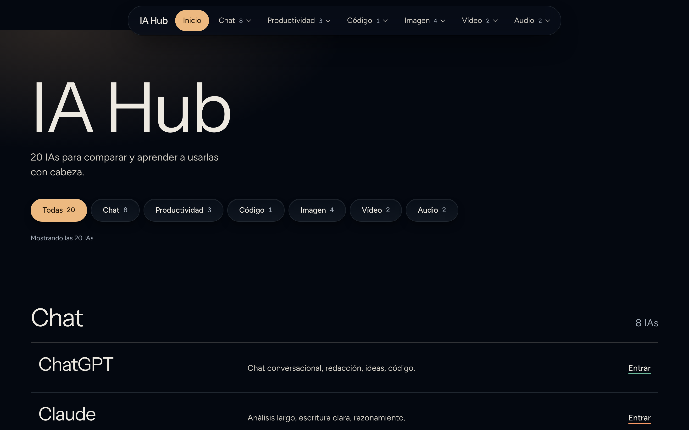
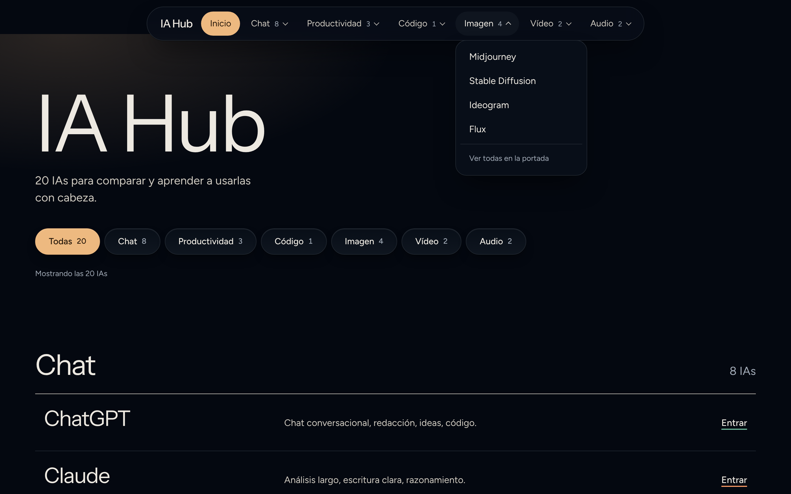
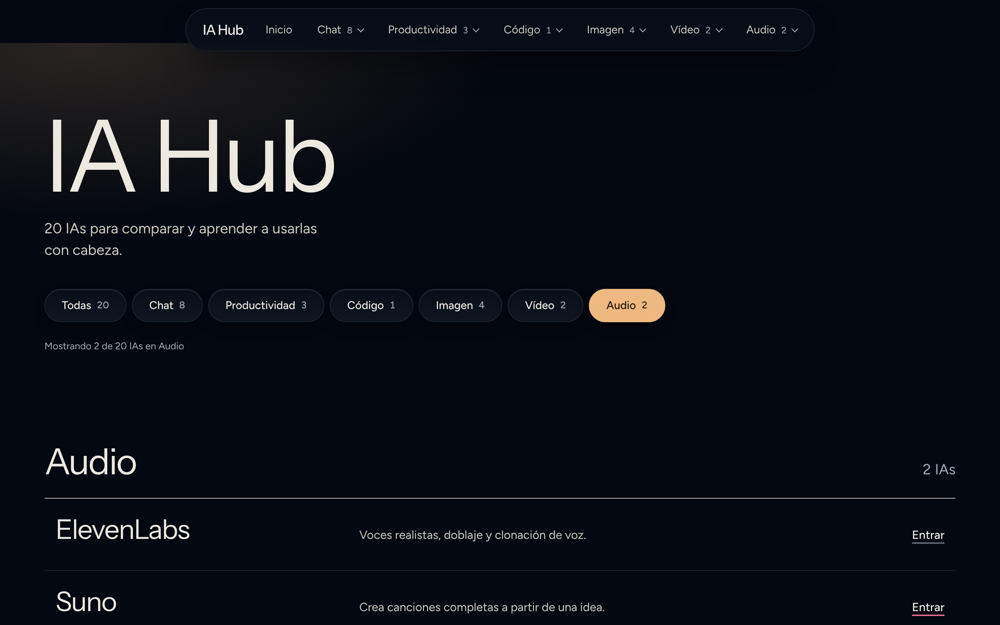
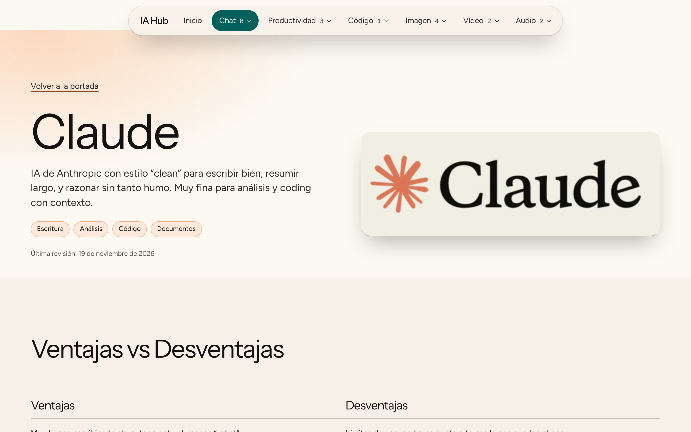
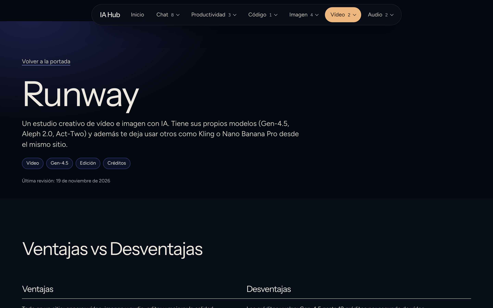
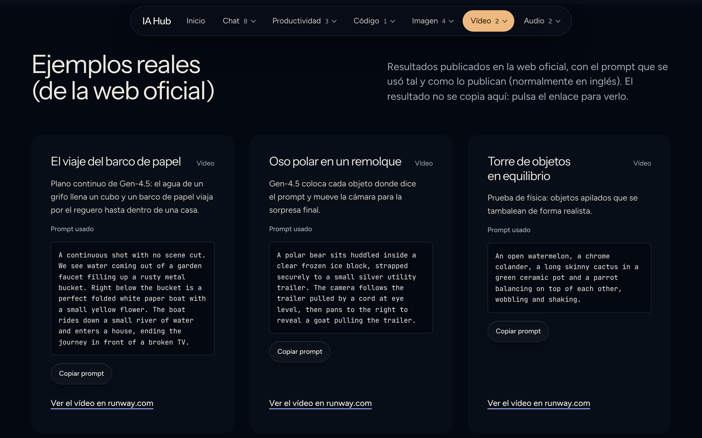
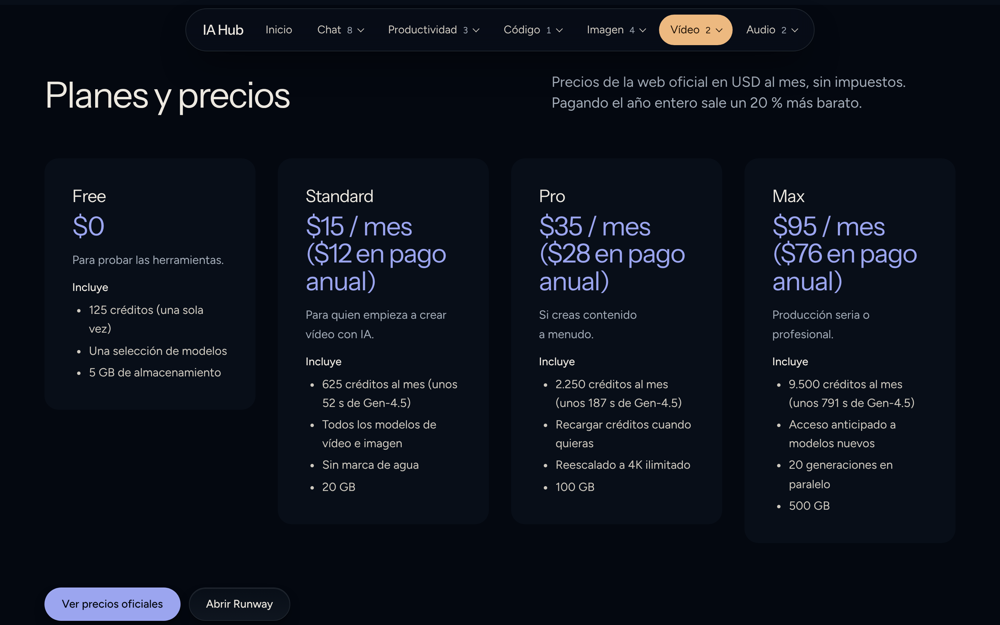
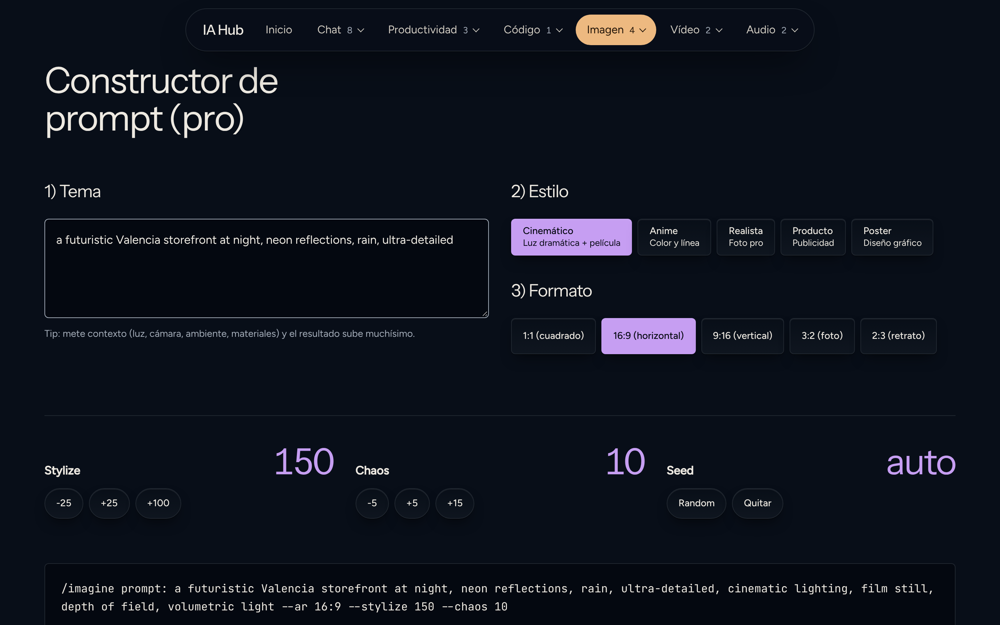
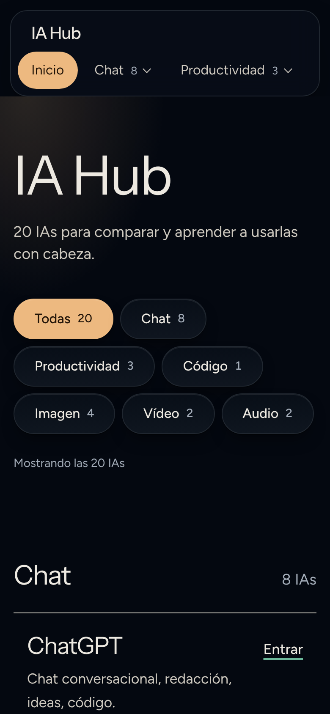
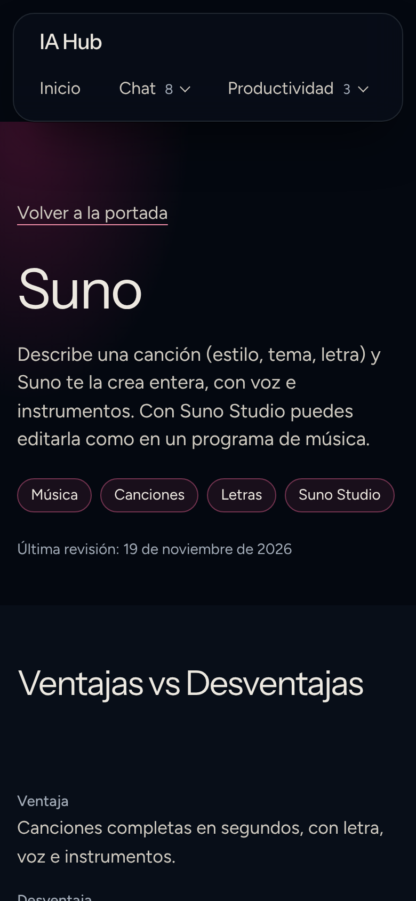

# IA Hub

Panel informativo para **comparar 20 inteligencias artificiales y aprender a usarlas con cabeza**: ventajas y desventajas, planes y precios verificados en las webs oficiales, prompts que funcionan y ejemplos reales publicados por cada IA.

Trabajo de Fin de Grado de **Desarrollo de Aplicaciones Web (DAW)**, hecho con **Angular 21**.

**Web publicada:** <https://web-ia.guillegarfon.workers.dev>



## Capturas

| Portada e índice por categorías | Menú desplegable por categoría |
|---|---|
|  |  |
| **Filtro por categoría (`/?categoria=Audio`)** | **Ficha clara (Claude)** |
|  |  |
| **Ficha oscura (Runway)** | **Ejemplos reales con su prompt** |
|  |  |
| **Planes y precios verificados** | **Constructor de prompts (Midjourney)** |
|  |  |

| Móvil: portada | Móvil: ficha |
|---|---|
|  |  |

## Qué ofrece

- **20 IAs en 6 categorías:** Chat, Productividad, Código, Imagen, Vídeo y Audio.
- **Una ficha por IA** con ventajas y desventajas, para qué sirve, **planes y precios** con la fecha de su última revisión, **prompts para copiar** y **ejemplos reales** de la web oficial (el resultado enlazado y el prompt exacto).
- **Portada como índice:** las IAs agrupadas por categoría, con un **filtro** que se guarda en la URL para poder compartirlo.
- **Menú con un desplegable por categoría**, usable con teclado y en móvil.
- **Constructor interactivo de prompts** para Midjourney (estilo, formato, stylize, chaos y seed).
- **Modo claro u oscuro y color propio** para cada IA.

## Tecnologías

| | |
|---|---|
| Framework | Angular 21 (componentes con `NgModule`, signals, control flow `@if`/`@for`/`@switch`) |
| Lenguaje | TypeScript 5.9 |
| Estilos | SCSS + CSS con tokens (custom properties en OKLCH) |
| Tests | Vitest con el builder `@angular/build:unit-test` |
| Diseño | Skill **Hallmark** para Claude Code (tema Ribbon), fijado en [`design.md`](design.md) |
| Despliegue | Cloudflare Workers (recursos estáticos en modo SPA) o Cloudflare Pages |

## Arquitectura: el contenido son datos

Ningún componente tiene texto de una IA concreta. **Todo el contenido vive en datos** y una sola plantilla lo pinta:

```
src/app/
├── data/
│   ├── ai-model.ts          tipos: AiProfile, categorías, los 8 tipos de sección…
│   └── ais/
│       ├── <slug>.ts        un archivo por IA: textos, colores, secciones y fecha de revisión
│       └── index.ts         registro de las 20 IAs (el orden es el de la portada y el menú)
├── pages/
│   ├── home/                portada: índice agrupado y filtro por categoría
│   └── ai-detail/           UNA plantilla para las 20 fichas (/ia/:slug)
├── components/
│   └── prompt-builder/      constructor de prompts (Midjourney)
├── services/
│   └── page-meta.ts         título, descripción, Open Graph y enlace canónico por página
└── app.*                    menú por categorías, pie y gestión del foco al navegar
```

- **Rutas:** `/` (portada), `/ia/:slug` (ficha) y las rutas antiguas (`/claude` → `/ia/claude`). Un *guard* deja pasar solo los *slugs* que existen; el resto vuelve a la portada.
- **Tipos de sección:** `prosCons`, `cards`, `prompts`, `plans`, `keyValues`, `gallery`, `examples` y `promptBuilder`. TypeScript comprueba cada sección con su tipo (unión discriminada por `type`).

## Diseño

El rediseño se hizo con la skill **Hallmark** (tema Ribbon) y el sistema está fijado en [`design.md`](design.md):

- **Tipografías:** Instrument Sans en los titulares, Figtree en el texto y JetBrains Mono en los prompts. Se sirven desde la propia web (licencia OFL), así que no hay peticiones a Google Fonts.
- **Dos variantes de color:** *dawn* (clara) y *two-in-the-morning* (nocturna), como bloques de tokens en `[data-mode]`. Cada IA elige la suya y su color, que se mezcla en OKLab para que el contraste sea suficiente en los dos modos.
- **Comprobación:** el linter de Hallmark (`sloplint`) se ha pasado por las 21 páginas: 0 errores y 0 avisos sin resolver. Las excepciones están registradas con su motivo en `src/styles/tokens.css`.

## Calidad

### Tests

**49 tests** con Vitest (`npm test`). Cubren:

- **Datos:** *slugs* únicos, enlaces `https`, fechas de revisión válidas, ningún plan sin precio, categorías, ejemplos bien formados, imágenes con su tamaño y ningún GIF.
- **Portada:** índice, filtro sincronizado con la URL y metadatos.
- **Menú:** un desplegable por categoría, Escape devuelve el foco, clic fuera y cambio de página.
- **Ficha:** secciones, temas, ejemplos, fecha de revisión, metadatos y animaciones paradas hasta que el usuario las pone en marcha.

### Accesibilidad (WCAG 2.2 AA)

- **axe-core 4.14** en las 21 páginas, en escritorio y en móvil: **0 violaciones** (reglas `wcag2a`, `wcag2aa`, `wcag21aa`, `wcag22aa` y buenas prácticas).
- **Contraste:** el linter de Hallmark lo comprueba sobre los píxeles reales (también sobre degradados, donde axe no puede): sin fallos.
- **Teclado:**
  - Enlace "Saltar al contenido" que lleva el foco al `<main>`.
  - Foco visible (2 px) en todos los controles.
  - Los desplegables tienen `aria-expanded`, se cierran con Escape y devuelven el foco a su botón.
  - Al cambiar de página, el foco pasa al contenido nuevo; al filtrar, no se mueve.
- **Movimiento:**
  - Las animaciones empiezan **paradas**, con un botón "Ver animación" / "Pausar animación" (criterio 2.2.2).
  - Se respeta `prefers-reduced-motion`.
- **Botones y documento:** los botones miden 44 px o más; el documento es `lang="es"`.

### Rendimiento y SEO (Lighthouse 13.6, móvil)

Medido en local con el build de producción servido por Wrangler, con la emulación de móvil de Lighthouse (red y CPU ralentizadas). Las 21 páginas:

| Página | Rendimiento | Accesibilidad | Buenas prácticas | SEO | LCP | CLS | Peso |
|---|---|---|---|---|---|---|---|
| `Portada` | 95 | 100 | 100 | 100 | 0,6 s | 0 | 178 KiB |
| `/ia/chatgpt` | 94 | 100 | 100 | 100 | 2,3 s | 0 | 223 KiB |
| `/ia/claude` | 93 | 100 | 100 | 100 | 2,6 s | 0 | 294 KiB |
| `/ia/copilot` | 95 | 100 | 100 | 100 | 2,3 s | 0 | 233 KiB |
| `/ia/cursor` | 96 | 100 | 100 | 100 | 0,6 s | 0 | 198 KiB |
| `/ia/deepseek` | 97 | 100 | 100 | 100 | 0,6 s | 0 | 198 KiB |
| `/ia/elevenlabs` | 91 | 100 | 100 | 100 | 0,6 s | 0 | 198 KiB |
| `/ia/flux` | 92 | 100 | 100 | 100 | 0,6 s | 0 | 198 KiB |
| `/ia/gemini-notebook` | 98 | 100 | 100 | 100 | 0,6 s | 0 | 198 KiB |
| `/ia/gemini` | 96 | 100 | 100 | 100 | 0,6 s | 0 | 238 KiB |
| `/ia/grok` | 97 | 100 | 100 | 100 | 0,6 s | 0 | 198 KiB |
| `/ia/ideogram` | 98 | 100 | 100 | 100 | 0,6 s | 0 | 198 KiB |
| `/ia/kling` | 93 | 100 | 100 | 100 | 0,6 s | 0 | 198 KiB |
| `/ia/llama` | 97 | 100 | 100 | 100 | 0,6 s | 0 | 198 KiB |
| `/ia/midjourney` | 97 | 100 | 100 | 100 | 2,4 s | 0 | 248 KiB |
| `/ia/mistral` | 90 | 100 | 100 | 100 | 2,6 s | 0 | 305 KiB |
| `/ia/perplexity` | 97 | 100 | 100 | 100 | 0,6 s | 0 | 198 KiB |
| `/ia/qwen` | 96 | 100 | 100 | 100 | 0,6 s | 0 | 198 KiB |
| `/ia/runway` | 95 | 100 | 100 | 100 | 0,6 s | 0 | 198 KiB |
| `/ia/stable-diffusion` | 94 | 100 | 100 | 100 | 0,6 s | 0 | 198 KiB |
| `/ia/suno` | 98 | 100 | 100 | 100 | 0,6 s | 0 | 198 KiB |

**Resumen:** rendimiento entre **90 y 98** (media 95), **100** en accesibilidad, buenas prácticas y SEO en las 21 páginas, y **CLS 0** en todas.

Mejoras que lo hicieron posible:

- **Animaciones de Midjourney** pasadas de GIF a WebP animado, con fotograma fijo de portada: de **36 MB a 248 KB** en la carga inicial de la ficha.
- **Tipografías** alojadas en la web y precargadas.
- **Tamaño real** declarado para cada imagen de cabecera, para que no salte la maquetación (CLS 0).

**SEO:**
- Título, descripción, Open Graph y enlace canónico propios en cada página.
- `sitemap.xml` y `robots.txt`, generados en cada build a partir de los datos.

## Rigor del contenido

- **Fuentes oficiales:** precios, planes y modelos se han comprobado en las **webs oficiales**. Cada ficha muestra la fecha de su última revisión.
- **Nada inventado:** lo que no se puede verificar aparece como **"Consultar web oficial"**, con el enlace. Un test obliga a que esa sección tenga el enlace.
- **Ejemplos reales:** el prompt se copia literalmente de la web oficial (o se marca como fragmento) y el resultado se **enlaza**, no se copia, por derechos de autor.

## Cómo ejecutarlo

Requisitos: **Node 22** (lo fija `.node-version`; Angular 21 pide `^20.19 || ^22.12 || >=24`).

```bash
npm ci
```

```bash
npm start
```

Abre <http://localhost:4200/>. Otros comandos:

```bash
npm test
```

```bash
npm run build
```

`npm run build` genera la web en `dist/ia-hub/browser`. Antes crea el `sitemap.xml` (`prebuild`) y después comprueba que la salida está lista para Cloudflare (`postbuild`).

Para probarla en local tal y como la sirve Cloudflare:

```bash
npx wrangler@4.156.0 dev
```

## Cómo añadir una IA

1. Copia un archivo de `src/app/data/ais/` (por ejemplo `claude.ts`) con el nombre de la nueva IA.
2. Cambia `slug`, `name`, `category` (una de `AI_CATEGORIES`: Chat, Productividad, Código, Imagen, Vídeo o Audio), `summary`, los textos, `lastReviewed` (`AAAA-MM-DD`, el día que revisaste la web oficial), `theme` (modo, color y, si tiene imagen, `heroImage` con su `heroImageSize`) y `sections`.
3. Añádela a la lista `AIS` de `src/app/data/ais/index.ts`.

La portada, el menú, el filtro, la ruta `/ia/<slug>`, los metadatos y el `sitemap.xml` se generan solos, y el estilo sale de [`design.md`](design.md).

## Despliegue en Cloudflare

Está publicada como **Cloudflare Worker** con recursos estáticos (`wrangler.jsonc`). Formulario de Cloudflare:

| Opción | Valor |
|---|---|
| Project name | `web-ia` (igual que `name` en `wrangler.jsonc`) |
| Build command | `npm run build` |
| Deploy command | `npx wrangler deploy` |

**Recargar `/ia/claude` no da 404**, porque `wrangler.jsonc` usa `not_found_handling: "single-page-application"`.

**Alternativa con Cloudflare Pages:**

| Opción | Valor |
|---|---|
| Framework preset | `None` |
| Build command | `npm run build` |
| Build output directory | `dist/ia-hub/browser` |

Pages también sirve `index.html` en cualquier ruta porque no hay un `404.html` en la raíz; el `postbuild` impide que se cuele uno.

Cada fusión en `main` se publica sola.

## Historial del proyecto

| Fase | Qué se hizo | PR |
|---|---|---|
| 1 | Refactor: las páginas de IA pasan a ser datos + una plantilla | [#1](https://github.com/GuillermoGarciaFonseca/ia-hub-daw/pull/1) |
| 2 | Actualización de las 10 IAs con datos oficiales y fecha de revisión | [#2](https://github.com/GuillermoGarciaFonseca/ia-hub-daw/pull/2) |
| 3 | 10 IAs nuevas, menú por categorías, filtro y ejemplos reales | [#3](https://github.com/GuillermoGarciaFonseca/ia-hub-daw/pull/3) |
| 4 | Preparación para Cloudflare y Mistral Large 4 | [#4](https://github.com/GuillermoGarciaFonseca/ia-hub-daw/pull/4), [#5](https://github.com/GuillermoGarciaFonseca/ia-hub-daw/pull/5) |
| 5 | Rediseño completo con la skill Hallmark | [#6](https://github.com/GuillermoGarciaFonseca/ia-hub-daw/pull/6), [#7](https://github.com/GuillermoGarciaFonseca/ia-hub-daw/pull/7) |
| 6 | Revisión de las 20 fichas | [#8](https://github.com/GuillermoGarciaFonseca/ia-hub-daw/pull/8) |
| 7 | Sistema de diseño fijado en `design.md` | [#9](https://github.com/GuillermoGarciaFonseca/ia-hub-daw/pull/9) |
| 8 | Precios verificados y ejemplos para todas las IAs | [#10](https://github.com/GuillermoGarciaFonseca/ia-hub-daw/pull/10) |
| 9 | Pulido para la defensa: metadatos, accesibilidad, rendimiento y este README | [#11](https://github.com/GuillermoGarciaFonseca/ia-hub-daw/pull/11) |

## Limitaciones y trabajo futuro

- **Precios que cambian:** cambian a menudo. Por eso cada ficha muestra su fecha de revisión, y conviene repasarlos antes de cada entrega.
- **Sin verificar:** los importes de **ChatGPT** (su web solo los muestra a visitantes reales) y el precio del chat de **DeepSeek** (no lo publica).
- **Galerías:** solo Midjourney tiene galería propia. Las demás fichas podrían tener capturas hechas por el autor.
- **Renderizado en servidor:** la web se pinta en el navegador. Con prerenderizado (SSR/SSG) mejorarían todavía más la primera carga y el SEO.

## Licencias y créditos

- **Tipografías:** Instrument Sans, Figtree y JetBrains Mono, bajo la SIL Open Font License 1.1 (ver `public/fonts/LICENSE.txt`).
- **Marcas y logotipos:** los nombres, marcas y logotipos de cada IA pertenecen a sus dueños y aparecen solo con fines informativos.
- **Ejemplos:** los ejemplos de resultados se enlazan a la web oficial de cada IA.
